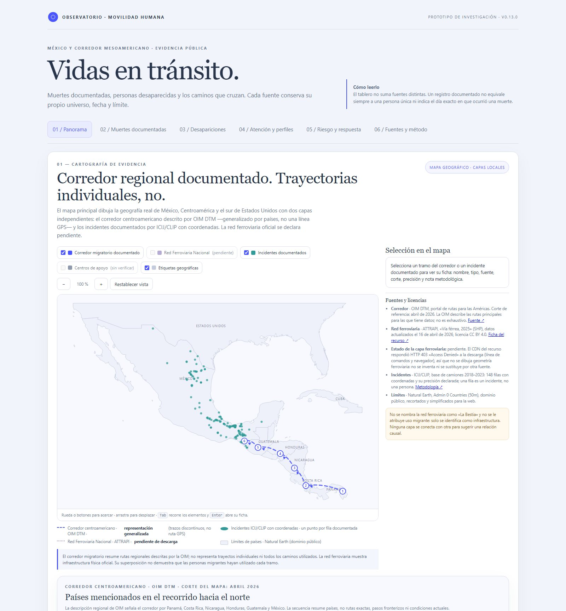

# Vidas en tránsito · Observatorio de movilidad y violencia

Tablero de datos abiertos sobre **movilidad migratoria, desapariciones y violencia
documentada** en el corredor hacia y por México. Reúne cinco fuentes que observan
fenómenos distintos y las mantiene separadas en unidades, cobertura y periodo.
Cuando un dato falta, lo dice; cuando la cobertura es parcial, lo advierte.

[](https://github.com/Dev-HugoAguilar/vidas-en-transito/actions/workflows/tests.yml)
[](#por-qué-no-se-incluyen-los-insumos-crudos)
[](#atención-y-perfiles)

> **Advertencia de lectura.** Cada fuente tiene su propia unidad: eventos
> administrativos, incidentes documentados, elementos de una capa de servicios,
> casos no localizados y filas de atención. **Las cifras de fuentes distintas no
> se suman.** Una fila de incidente no es una persona; una celda vacía no es un
> cero.

---

## Demo

```bash
git clone https://github.com/Dev-HugoAguilar/vidas-en-transito.git
cd vidas-en-transito
python -m http.server 8000 --directory web
```

Abre <http://127.0.0.1:8000/>. El tablero es HTML, CSS y JavaScript sin
compilación; los datos se sirven como JSON desde la misma carpeta.



## Seis vistas

| Vista | Qué contiene |
|---|---|
| **Panorama** | Corredor OIM, incidentes ICIJ/CLIP, red ferroviaria, zonas INM, edad × sexo, país de nacimiento y destino. |
| **Muertes** | Mapa hexagonal de incidentes documentados, con fuente conmutable. |
| **Desapariciones** | Explorador EAAF con sus cuatro unidades y dos cortes separados. |
| **Contexto** | Eventos registrados por UPMRIP y devoluciones por tipo de resolución. |
| **Rutas** | El corredor leído por celdas, como descripción regional, no como trayecto. |
| **Método** | Fuentes, definiciones, periodos y límites de cada indicador. |

Todas las visualizaciones tienen tabla accesible, leyenda explícita y nota de
unidad.

## Las cinco fuentes, sin mezclarlas

| Fuente | Unidad | Cobertura usada |
|---|---|---|
| **UPMRIP/SEGOB** (Boletín Estadístico, Cuadro 3.1) | Eventos administrativos de personas en situación migratoria irregular | 2021–2025 completo y 2026 enero–septiembre parcial |
| **UPMRIP/SEGOB** (Cuadro 3.2.3) | Devoluciones por tipo de resolución | Serie publicada, sin apilar tipos |
| **ICIJ/CLIP** | Incidentes documentados, no personas | 156 incidentes, 148 con coordenadas (2018–2023) |
| **OIM DTM** | Elementos de una capa de servicios, cobertura parcial | 3,822 elementos en ocho países |
| **EAAF · Proyecto Frontera** | Casos no localizados, familias, donantes e identificaciones | Corte 28-feb-2025 y agregados del 14-ago-2026 |
| **REDODEM** | Filas de atención u observación | 40,800 filas (2023–2024) |

Decisiones que se sostienen en toda la interfaz:

- **No se anualiza** el corte parcial de 2026 ni se proyecta.
- **No se convierte** un campo vacío en cero.
- **No se infieren** edad, sexo ni nacionalidad cuando la fuente no las publica.
- **No se conectan** como tendencia cortes con distinta definición o nivel de
  detalle.
- **No se presentan** rutas de «La Bestia» ni trayectos individuales: la geometría
  ferroviaria y el corredor son referencias territoriales.

## Atención y perfiles

El bloque REDODEM es el más delicado:

- La unidad es la **fila de atención u observación**: 40,800 filas no equivalen a
  40,800 personas, ni a una muestra representativa, ni a una prevalencia.
- **Motivos**: 14 combinaciones observadas en un UpSet; 6,338 filas con algún
  motivo y 7,863 menciones. `NA` no es un motivo y no se reparte.
- **Violencias × perpetradores**: 469 filas con ambos campos sostienen 950
  coapariciones. Una ficha puede declarar varias violencias y varios
  perpetradores, así que las categorías no suman 100 %.
- **Privacidad**: se aplica un **umbral de 5**. Las celdas con 1 a 4 filas se
  muestran como rango suprimido; los pares con cero no se listan. El umbral se
  declara en la interfaz, en el dato y en esta documentación.
- **Rankings**: 737 menciones de violencia en 14 categorías y 597 de perpetrador
  en 10. Una fila puede aportar varias menciones.
- **Cobertura del campo**: 317 de 22,123 filas en 2023 (1.43 %) y 182 de 18,677 en
  2024 (0.97 %). La línea describe la presencia del campo, no la evolución de la
  violencia.

## Por qué no se incluyen los insumos crudos

Este repositorio **no redistribuye** los XLS del Boletín Estadístico ni el CSV de
REDODEM. Los scripts de `pipeline/` esperan encontrarlos en `insumos_fuente/`,
carpeta que no se versiona; el detalle de nombres, cortes y licencias está en
[`docs/FUENTES_Y_LIMITES.md`](docs/FUENTES_Y_LIMITES.md). Se publican solo los
agregados y derivados necesarios para reproducir el tablero.

Una prueba de la suite falla a propósito si alguien versiona `*.xls`, `*.csv`,
`*.zip` o la carpeta `insumos_fuente/`. La regla es ejecutable, no una promesa.

## Estructura

```text
web/                      Aplicación del tablero (sin compilación)
  index.html              Seis vistas y contenido editorial
  data.json               Agregados previos (MMP, El Paso, EAAF, REDODEM)
  fuentes_ampliadas.json  Agregados y puntos de la ampliación
  geografia/*.geojson     Capas territoriales publicadas
  burbujas.js, hexmap.js  Componentes de visualización
pipeline/                 Scripts de derivación y construcción
tests/test_datos.py       Contrato de datos y guarda de no redistribución
docs/                     Fuentes, cartografía, inventario y método
```

## Reproducir los agregados

Los scripts de `pipeline/` derivan los agregados desde los insumos descargados
localmente y `construir.py` publica la copia servible. El orden, los nombres de
archivo y las fuentes de cada insumo están en
[`pipeline/README.md`](pipeline/README.md); la carpeta de insumos excluidos se
indica con `--insumos RUTA` o con `MIGRATION_SOURCE_DIR`:

```bash
python -m pip install -r pipeline/requirements.txt
python pipeline/derive_data.py                              # UPMRIP, ICIJ/CLIP y capa OIM
python pipeline/preparar_redodem.py --insumos RUTA          # cruces, UpSet y matriz con umbral 5
python pipeline/construir.py                                # publica dist/ verificando hashes
```

`construir.py` funciona sin insumos: verifica `web/` contra
`docs/MANIFEST_LOCAL.json` y copia los 15 archivos publicados a `dist/`.

`preparar_eaaf.py` es una herramienta sin conexión que reconstruye el detalle
EAAF desde la transcripción del PDF; no forma parte del runtime.

## Datos, atribución y límites

Las fuentes, sus definiciones, periodos y condiciones se documentan en
[`docs/FUENTES_Y_LIMITES.md`](docs/FUENTES_Y_LIMITES.md); las decisiones
cartográficas, en [`docs/CARTOGRAFIA.md`](docs/CARTOGRAFIA.md). Este repositorio no
incluye un archivo `LICENSE` propio: se respetan las condiciones de cada fuente.

Límites que conviene tener presentes:

- El corredor de OIM es una descripción regional generalizada, no una ruta.
- La capa de servicios es parcial y no certifica que cada elemento sea un albergue
  activo.
- La entidad de registro de UPMRIP no es necesariamente el lugar del hecho.
- Los cortes del EAAF tienen distinto nivel de detalle y no se enlazan como serie.
- Los calendarios de MMP y El Paso usan fechas de reporte, no de fallecimiento.

## Contribuir y seguridad

Convenciones en [`CONTRIBUTING.md`](CONTRIBUTING.md). Para reportar un problema,
usa los avisos privados de [`SECURITY.md`](SECURITY.md). Si detectas un error de
lectura o una cifra mal atribuida, abre un *issue*: en este proyecto la corrección
de una unidad vale más que una visualización nueva.
